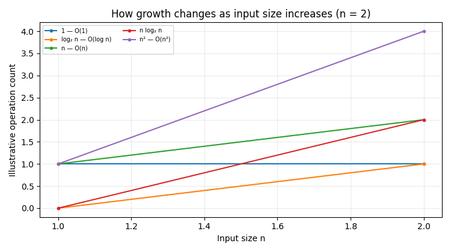

# Asymptotic Notations — Big O, Big Omega and Big Theta

**DAA Assignment | UPES, School of Computer Science**

This project demonstrates how common algorithmic growth rates change as input size increases.

## Animation Preview



The animation compares these illustrative functions:

- **O(1)** — constant
- **O(log n)** — logarithmic
- **O(n)** — linear
- **O(n log n)** — linearithmic
- **O(n²)** — quadratic

These curves illustrate growth trends; they are not measured execution times from a particular computer.

## Repository Contents

- `main.py` — Python source for the animation
- `requirements.txt` — required Python packages
- `growth_rates_animation.gif` — animated demonstration
- `growth_rates.png` — comparison plot
- `frame1.png` to `frame4.png` — four keyframe screenshots
- `report.pdf` — assignment report
- `report.tex` — editable LaTeX source
- `references.bib` — bibliography source

## How to Run

Install Python 3, then open a terminal in this folder and run:

```bash
pip install -r requirements.txt
python main.py
```

The script displays the animation and saves `growth_rates_animation.gif` in the current working directory.

## Core Idea

- **Big O, O(g(n))** describes an asymptotic upper bound.
- **Big Omega, Ω(g(n))** describes an asymptotic lower bound.
- **Big Theta, Θ(g(n))** describes a tight asymptotic bound when matching upper and lower bounds exist.

For example, `3n² + 5n + 2 = Θ(n²)` because the quadratic term determines the function's growth for sufficiently large `n`.

## References

1. Cormen, Leiserson, Rivest, and Stein, *Introduction to Algorithms*, 4th ed., MIT Press, 2022.
2. Knuth, *The Art of Computer Programming, Volume 1: Fundamental Algorithms*, 3rd ed., Addison-Wesley, 1997.
3. Skiena, *The Algorithm Design Manual*, 3rd ed., Springer, 2020.

## AI Tool Use

ChatGPT assisted with structuring and drafting explanations and generating example code and figures. The submitted declaration should accurately describe the assistance used and comply with the course policy.
